<p align="center">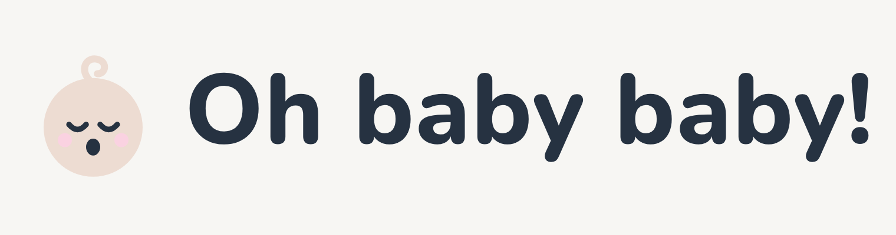</p>

# Oh baby baby!

A simple Flutter app for logging a baby's feeds, pumping, diapers, routines and anything else (weight, temperature, medicine, vaccines, firsts), with daily and weekly summaries.

## Features

- **Logging happens in drawers.** *Add an entry* opens a drawer to pick what to log; each kind opens a tall drawer with Close, the title and Save at the top, in its own colour.
  - **Breastfeeding**: start, pause or switch the left and right timers, or tap the pencil to type a side's time. A "Last side" tag marks where the previous feed ended. *Ended on* fills in from the last timer used.
  - **Bottle feeding**: pick **breast milk** or **formula**, set the amount with −/+ (10 ml steps) or by typing, or tap **Yes** to reuse the last amount.
  - **Pumping**: a timer, and the amount per side or in total (5 ml steps).
  - **Diaper**: wet, dirty (both together allowed) or dry, and a diaper-rash switch.
  - **Routine**: bath, nail trim, play time, story time, tummy time, vitamin or probiotic, walk or outdoor time, or something typed.
  - **Other**: one entry for anything else. Presets for weight (kg), height (cm), head size (cm), temperature (°C), medicine, vaccine and baby firsts, or *Something else* with your own name, value and unit.
  - Every entry has a time and notes. Closing a drawer with unsaved input asks first; editing an entry adds *Delete entry*.
- **Two tabs**
  - **Today** (landing page): a floating *Add an entry* button; **Quick add** tiles that open a breastfeeding or pumping timer card, or log a repeat of the last bottle or a wet or dirty diaper at once (with Undo). The timer does not start on its own: it starts when you pick a side (*Start left* / *Start right*, with the last side marked) or tap *Start* for pumping. From then on you can switch side, pause, finish to review and save, or discard, and it keeps running in the background and across app restarts. Below that, the day card shows a one-line *Last feeding*, chips with the day's totals (breastfeeding time, bottle ml, pumped ml, diapers), and the **Timeline** as the main content: each entry with its time on the left. Arrows step through days, and tapping the date opens a calendar to jump to any day, however long ago. Tap an entry to edit it, swipe left to delete it (with undo).
  - **Trends**: switch between **Week** and **Month**; arrows go back as far as you like, and tapping the dates opens a calendar to jump to any week or month. For the period on screen: the average per day of breastfeeding, formula, breast milk by bottle, pumping and diapers, compared with the previous period; how many times each routine happened; and **Measurements**, every number logged under Other (weight, height, head size, temperature, or your own) with its latest reading and the change since the one before. Each row has a small line of the last 8 weeks or 6 months (or the latest readings); tap it for a full chart and every value. Below that is a list of the days. Averages count finished days only, and none before the first entry ever logged.
- The baby's name can be edited by tapping it.
- Data is stored on the device with `shared_preferences`.

## Brand

- **Palette**: "Soft Pastel Shades" (`#EDDCD2` `#FFF1E6` `#FDE2E4` `#FAD2E1` `#C5DEDD` `#DBE7E4` `#F0EFEB` `#D6E2E9` `#BCD4E6` `#99C1DE`), used so colour has few jobs: a calm off-white page (`#F7F6F3`) with white cards and charcoal text (`#263241`); one action colour, a deep step of the blue (`#3D6E94`), for the main button on a screen; one selection colour, sky `#BCD4E6`, for anything chosen or running; and one soft colour per group of entries: all feeds rose (their icons tell breastfeeding, formula and breast milk apart), pumping lagoon, diapers taupe, routines mint, Other white with an outline. Every Material role in the theme is set from these. Chart lines use deeper steps of the same hues so they stay visible on white.
- **Logo**: a sleepy baby face with a curl of hair and a little "oh" mouth, in `assets/branding/` (SVG and PNG). App icons are generated from `ohbaby_app_icon.png` with `dart run flutter_launcher_icons`.
- **Name**: "Oh baby baby!" everywhere, except under the iPhone home-screen icon, which shows "Oh baby!" because iOS cuts off longer names.
- **Typefaces**: app text uses [TeX Gyre Heros](https://www.gust.org.pl/projects/e-foundry/tex-gyre/heros), a free font drawn after Helvetica (GUST Font License, `assets/fonts/GUST-FONT-LICENSE.txt`); Helvetica itself can't be bundled under its licence. The logo wordmark uses [Nunito](https://github.com/googlefonts/nunito) (SIL Open Font License, `assets/fonts/OFL.txt`).

## Run

```bash
flutter pub get
flutter run
```

## Test

```bash
flutter analyze
flutter test
```

## Structure

```
lib/
  main.dart                    app entry
  theme.dart                   colours and theme
  models/entry.dart            Entry model (every kind of entry) + JSON
  models/summary.dart          daily/weekly totals and formatting
  models/trends.dart           measurement series and routine counts
  models/live_timer.dart       breastfeeding/pumping timer started from Today
  data/entry_store.dart        in-memory store persisted to shared_preferences
  screens/main_shell.dart      bottom tabs (Today, Week)
  screens/today_screen.dart    landing page: quick add, day totals, timeline
  screens/entry_sheet.dart     add/edit drawers for every kind of entry
  screens/trends_screen.dart   Trends tab
  screens/trend_sheet.dart     full chart of one trend
  widgets/                     logo, presets, quick add + live timer, sparkline, trend chart, shared UI
```

## Screenshots

| Today | Add menu | Trends | Weight chart |
|---|---|---|---|
| 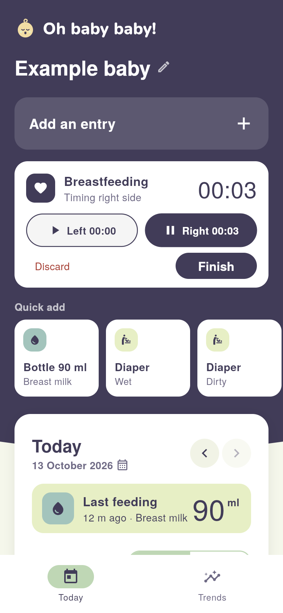 | 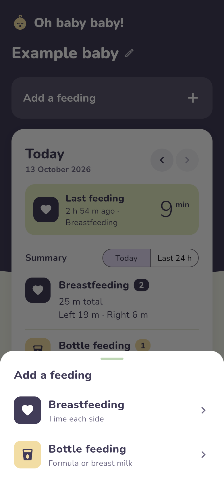 | 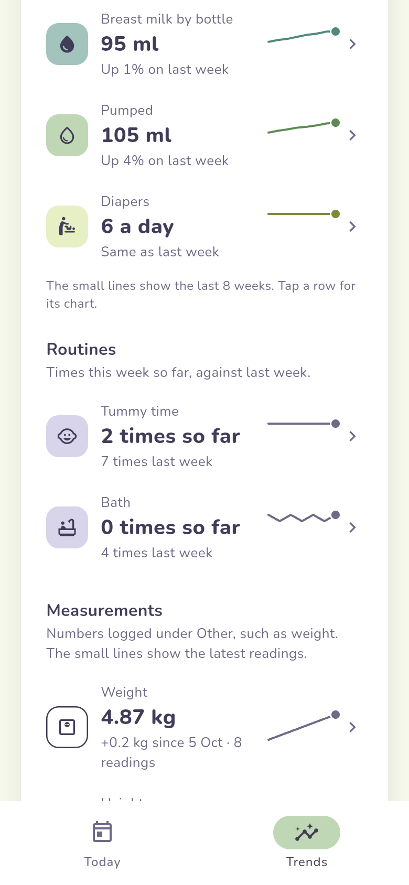 | 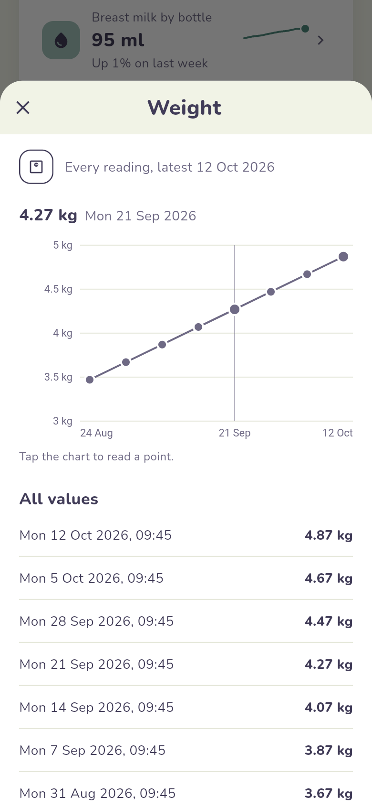 |

| Breastfeeding | Bottle | Pumping | Diaper | Routine | Other |
|---|---|---|---|---|---|
| 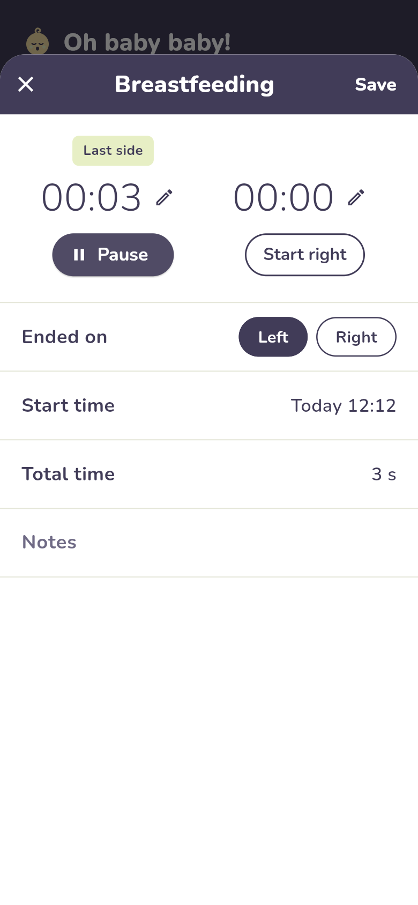 | 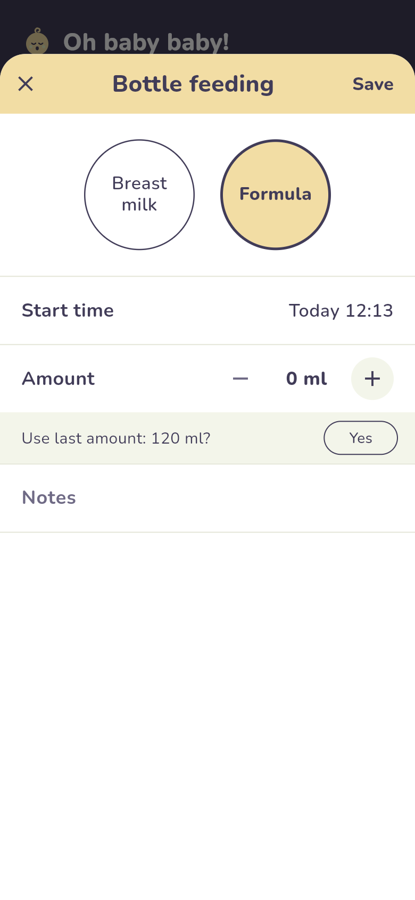 | 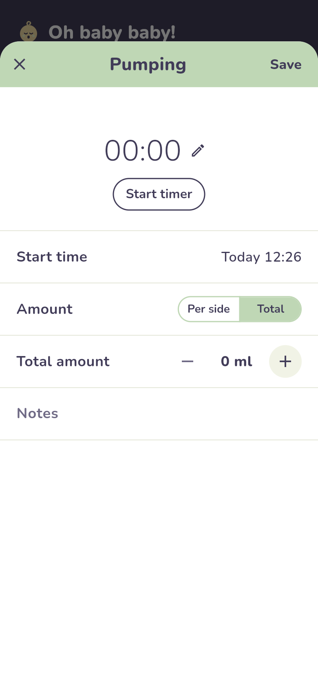 | 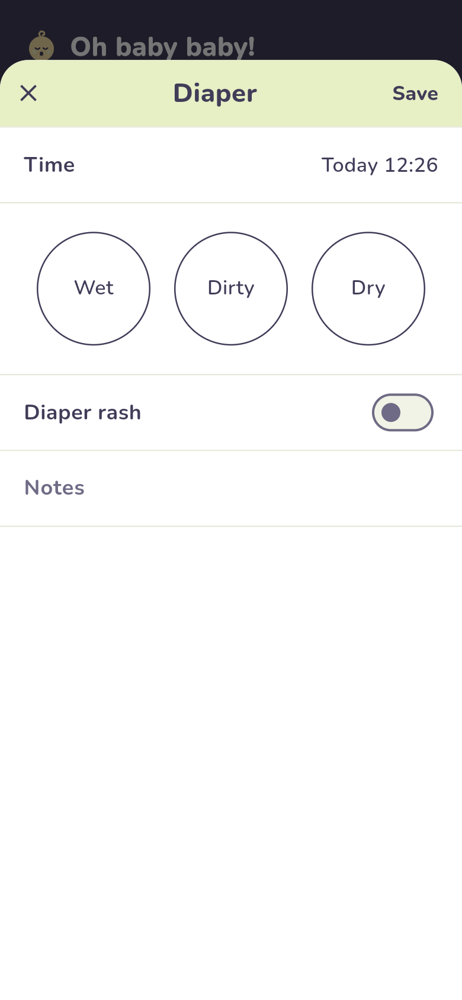 | 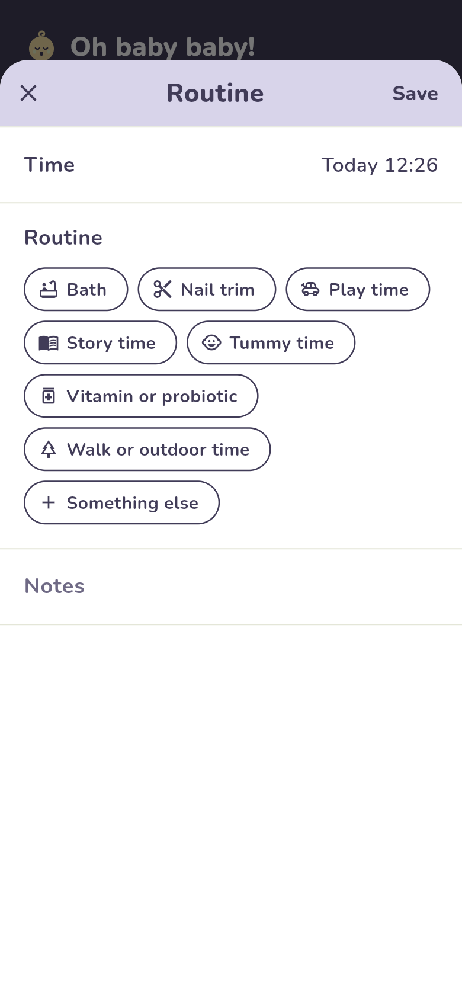 | 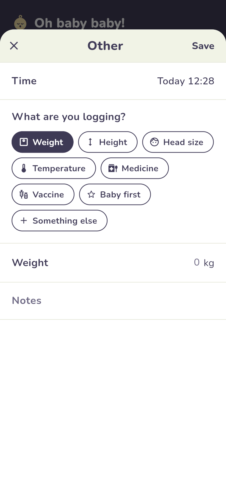 |
